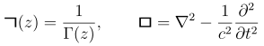
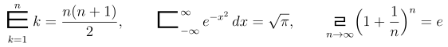
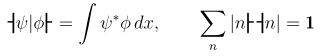
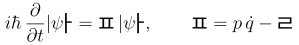
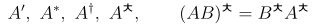
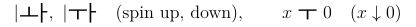
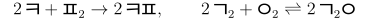

# hangulmath

**Hangul letters as math symbols for LaTeX.**

Mathematical notation draws almost entirely on Latin and Greek letters, and a long paper soon runs out of distinct ones.
`hangulmath` adds the 40 letters (*jamo*) of modern Korean Hangul as math symbols.
They are built from simple geometric strokes, look nothing like Latin or Greek, and each one has an established name.

<figure class="kx-texfig" markdown>
{ .kx-tex }
</figure>

```latex
\usepackage{hangulmath}
...
\[ \hangulsum\tiut_{k=1}^{n} \giug_k^{\,2}
   \le \Bigl(\hangulsum\tiut_{k=1}^{n} \giug_k\Bigr)^{2},
   \qquad \mium^2 \vec{A} = -\mu_0 \vec{J} \]
```

[Install](install.md){ .md-button .md-button--primary }
[Usage and symbol list](usage.md){ .md-button }
[hangulmath on CTAN](https://ctan.org/pkg/hangulmath){ .md-button }

## At a glance

- **40 symbols**: 14 consonants, 5 double consonants, 10 vowels and 11 compound vowels.
- **Easy to type**: `\giyeok` follows the official romanization, much as `\alpha` names α. Every consonant also has a four-letter alias such as `\giug`, `\niun`, `\diud`.
- **Real math symbols**: they take sub- and superscripts, scale in script styles, and work in running text too.
- **Operators from any symbol**: `\hangulsum`, `\hangulint` and `\hangullim` behave like `\sum`, `\int` and `\lim`.
- **No Korean font needed**: the glyphs come from a bundled subset of Noto Sans CJK KR.
- **Works with kotex** in either package order.
- Requires **XeLaTeX or LuaLaTeX**. Released under the LaTeX Project Public License 1.3c; the fonts are under the SIL Open Font License 1.1.

## What you can write

Every example below was typeset with hangulmath itself.

### Consonants as function names

<span class="kx-jamo">ㄱ</span> reads naturally as a function, and <span class="kx-jamo">ㅁ</span>, which looks like a box, makes a fitting d'Alembertian.

<div class="kx-ex" markdown>

```latex
\giug(z) = \frac{1}{\Gamma(z)}, \qquad
\mium = \nabla^2 - \frac{1}{c^2}
        \frac{\partial^2}{\partial t^2}
```

{ .kx-tex }

</div>

### Any symbol as an operator

<div class="kx-ex" markdown>

```latex
\hangulsum\tiut_{k=1}^{n} k = \frac{n(n+1)}{2}
\hangulint\diud_{-\infty}^{\infty} e^{-x^2}\,dx = \sqrt{\pi}
\hangullim\liul_{n\to\infty}\Bigl(1+\frac1n\Bigr)^{n} = e
```

{ .kx-tex }

</div>

### Vowels as brackets

<span class="kx-jamo">ㅓ</span> and <span class="kx-jamo">ㅏ</span> are mirror images, like ⟨ and ⟩.

<div class="kx-ex" markdown>

```latex
\eoh\psi|\phi\ah = \int \psi^*\phi\,dx, \qquad
\sum_n |n\ah\eoh n| = \mathbf{1}
```

{ .kx-tex }

</div>

### Hamiltonian and Lagrangian

<div class="kx-ex" markdown>

```latex
i\hbar\,\frac{\partial}{\partial t}|\psi\ah = \piup\,|\psi\ah,
\qquad \piup = p\,\dot q - \liul
```

{ .kx-tex }

</div>

### A new superscript mark

<div class="kx-ex" markdown>

```latex
A',\ A^*,\ A^\dagger,\ A^{\ciuc}, \qquad
(AB)^{\ciuc} = B^{\ciuc}A^{\ciuc}
```

{ .kx-tex }

</div>

### Arrows

<span class="kx-jamo">ㅗ</span> and <span class="kx-jamo">ㅛ</span> point up, <span class="kx-jamo">ㅜ</span> and <span class="kx-jamo">ㅠ</span> point down.

<div class="kx-ex" markdown>

```latex
|\oh\ah,\ |\uh\ah \quad (\text{spin up, down}),
\qquad x \mathrel{\uh} 0
```

{ .kx-tex }

</div>

### Element symbols

<div class="kx-ex" markdown>

```latex
2\,\kiuk + \piup_2 \to 2\,\kiuk\piup, \qquad
2\,\giug_2 + \iung_2 \rightleftharpoons 2\,\giug_2\iung
```

{ .kx-tex }

</div>

## Get it

`hangulmath` is on [CTAN](https://ctan.org/pkg/hangulmath) and in TeX Live.
The source is on [GitHub](https://github.com/krunyx/hangulmath), and the full manual is
[hangulmath-doc.pdf](https://mirrors.ctan.org/fonts/hangulmath/hangulmath-doc.pdf).
See [Install](install.md) to set it up locally or on Overleaf.
