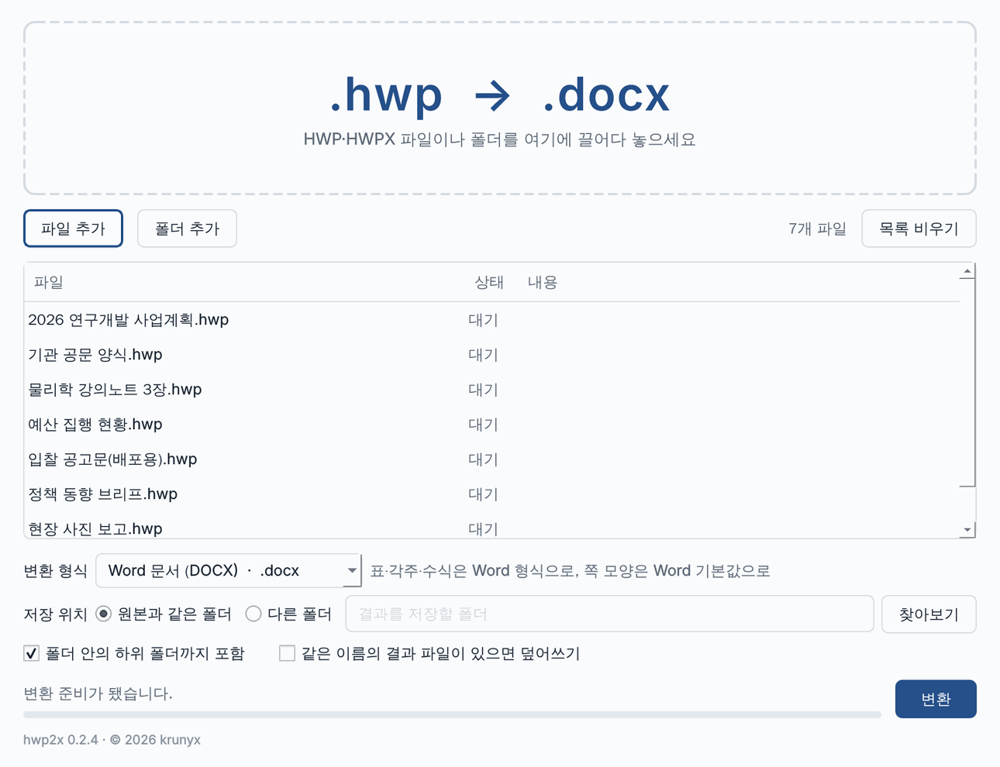
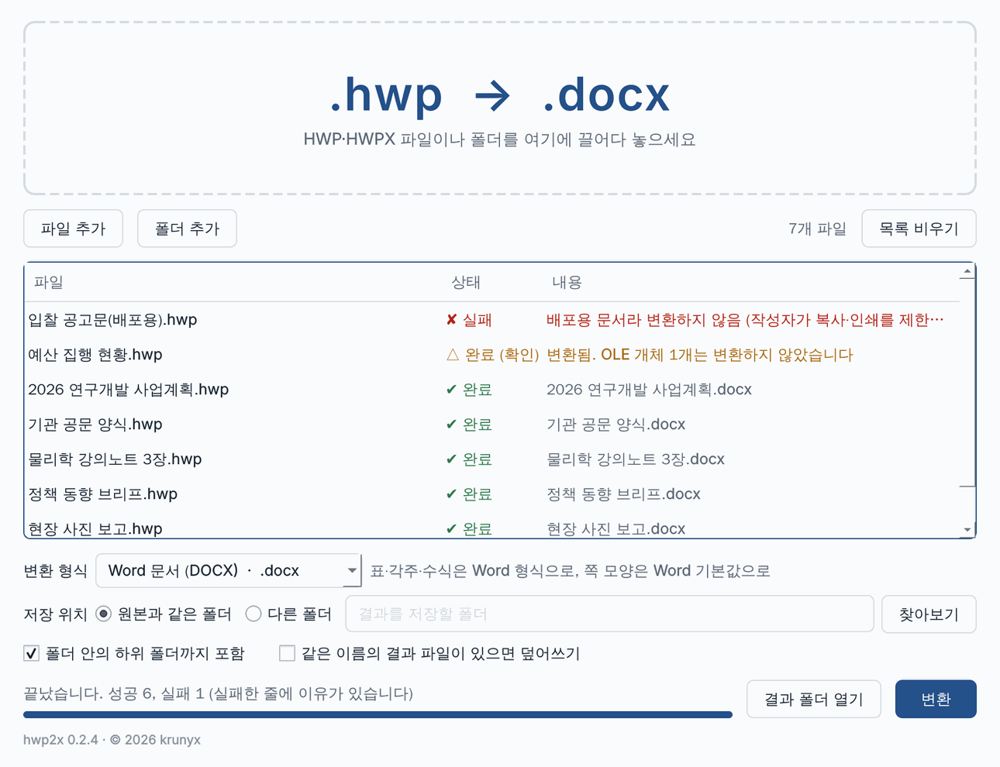

# hwp2x

**Convert Hangul word processor documents (HWP) to HWPX, and to Word, Markdown, HTML and LaTeX.**

HWPX is the open, XML-based successor to the binary HWP format, and Korean public institutions are moving to it.
hwp2x converts HWP files one at a time or a whole folder at once, on Windows, macOS and Linux.
Java is bundled, so there is nothing else to install.

[Download v0.2.4](#download){ .md-button .md-button--primary }
[How to use](#use){ .md-button }
[Report a problem](#feedback){ .md-button }

- **HWPX by default**, a faithful copy of the original. Word, Markdown, HTML, LaTeX and HyperTeX are there when you want a first draft in another format.
- **Long documents work.** Documents of hundreds or thousands of pages convert without running out of memory.
- **Drag and drop app** for everyday use, plus a **command line** for batch jobs.
- **Tested against 93 sample documents**, comparing the converted text with the original character by character.
- **Free** for personal, public-sector and commercial use, under the [Apache License 2.0](#license).

!!! info "The app is in Korean"
    hwp2x is made for Korean documents, so its window and messages are in Korean.
    This page gives each Korean label with its meaning.

## Download { #download }

The latest version is **v0.2.4** (November 2026). It is the version we recommend for everyone, whether you only need HWPX or want another format.

| System | Download | Size |
| --- | --- | --- |
| Windows 10/11, 64-bit | [hwp2x-0.2.4-windows-x64.zip](https://github.com/krunyx/hwp2x/releases/download/v0.2.4/hwp2x-0.2.4-windows-x64.zip) | 67 MB |
| macOS, Apple silicon (M1 and later) | [hwp2x-0.2.4-macos-arm64.dmg](https://github.com/krunyx/hwp2x/releases/download/v0.2.4/hwp2x-0.2.4-macos-arm64.dmg) | 60 MB |
| macOS, Intel | [hwp2x-0.2.4-macos-x64.dmg](https://github.com/krunyx/hwp2x/releases/download/v0.2.4/hwp2x-0.2.4-macos-x64.dmg) | 64 MB |
| Linux, 64-bit | [hwp2x-0.2.4-linux-x64.tar.gz](https://github.com/krunyx/hwp2x/releases/download/v0.2.4/hwp2x-0.2.4-linux-x64.tar.gz) | 103 MB |

### What's new { #whats-new }

**v0.2.4**

- In the About window, **최신 버전 확인** (Check for the latest version) now opens the [download section](#download) of this page.
- Conversion is the same as in v0.2.3.

**v0.2.3**

- The About window (**프로그램 정보**) now states the [license and terms of use](#license): the Apache License 2.0, no warranty, limitation of liability, checking your results, and trademarks.
  `hwp2x --license` prints the same terms on the command line.
- Conversion is the same as in v0.2.2.

**v0.2.2**

- The bottom of the window shows the version and copyright (for example hwp2x 0.2.2 · © 2026 krunyx). Click it to open **프로그램 정보** (About), with links to krunyx.com, the source code and the latest version, and the open-source notices.
  On macOS it is also in the app menu as **hwp2x에 관하여** (About hwp2x).
- The app has the krunyx icon. On Windows the version and copyright appear in the exe's **Properties → Details**; on macOS in Finder's **Get Info**.
- On Linux, `install.sh` adds hwp2x to your application menu.

**v0.2.1**

- **Long documents now convert.** Documents of several hundred pages could fail because the converter ran out of memory.
  It now processes a document in parts and needs about a quarter of the memory it did
  (a test document of about 3,000 pages: 3 GB → 768 MB).
- The converter may use up to 60% of your computer's memory (previously 25%), and retries once with more memory if that is not enough.
- If a document is still too large, the app says so plainly: "문서가 너무 커서 메모리가 부족합니다" (The document is too large; not enough memory).

v0.2.0 added Word, Markdown, HTML, LaTeX and HyperTeX output, `.hwpx` input and equation conversion. See [Output formats](#formats).

## Install { #install }

=== "Windows"

    1. Right-click the zip file and choose **Extract All**. Keep the extracted folder together; the program needs the files next to it.
    2. Run **`hwp2x-gui.exe`** to open the app.
    3. If a "Windows protected your PC" window appears, click **More info → Run anyway**. This happens only the first time.

=== "macOS"

    1. Open the `.dmg` file and drag **hwp2x** into your Applications folder.
    2. Before the first launch, open Terminal and run this once:

        ```bash
        xattr -dr com.apple.quarantine /Applications/hwp2x.app
        ```

        Without it, macOS may say the app "is damaged" or "cannot be verified", because the app is not yet signed by Apple.
        Alternatively, try to open the app once, then go to **System Settings → Privacy & Security** and click **Open Anyway**.

=== "Linux"

    ```bash
    tar xzf hwp2x-*-linux-x64.tar.gz
    ./hwp2x/install.sh       # optional: add hwp2x to your application menu
    ./hwp2x/hwp2x-gui        # the app
    ./hwp2x/hwp2x --help     # the command line
    ```

    `install.sh` adds a menu entry for your user only and needs no administrator rights.
    It points to the unpacked folder, so keep the folder where it is, or run `install.sh` again after moving it.

    Requires glibc 2.35 or later (Ubuntu 22.04 and newer).
    On a minimal system install `libegl1` and `libxkbcommon0`, and a Korean font such as `fonts-noto-cjk` so file names display correctly.

To update from an older version, install the new one in its place.

!!! note "About the security warnings"
    hwp2x is not yet code-signed by Apple or Microsoft, so your system warns on first launch.
    The downloads are built and packaged automatically, not by hand, and are the same files for everyone.

## How to use { #use }

### The app

The app looks the same on Windows, macOS and Linux.

<figure class="kx-shot" markdown>
[{ width="645" loading="lazy" }](../assets/images/hwp2x/app-ready.png)
<figcaption>Ready to convert: a folder of seven documents added, with Word (.docx) chosen as the output.</figcaption>
</figure>

1. **Add files.** Drag files or whole folders onto the dashed area at the top, or use
   **파일 추가** (Add files) and **폴더 추가** (Add folder).
   **목록 비우기** (Clear list) empties the list.
2. **Choose the output** under **변환 형식** (Output format).
   **HWPX** is the default; the others are Word, Markdown, HTML, LaTeX and HyperTeX.
   The large `.hwp → …` at the top and the note beside the menu show what you will get.
3. **Choose where to save** under **저장 위치** (Save location):
    - **원본과 같은 폴더** (Same folder as the original) — the default. `보고서.hwp` becomes `보고서.hwpx` next to it.
    - **다른 폴더** (Another folder) — pick a folder with **찾아보기** (Browse). Folder structure is kept.
4. **Set the options** if you need them:
    - **폴더 안의 하위 폴더까지 포함** — also convert files in sub-folders.
    - **같은 이름의 결과 파일이 있으면 덮어쓰기** — overwrite an existing result file with the same name. Without it, such files are skipped.
5. **Click 변환 (Convert).** Click it again to stop after the files in progress.

<figure class="kx-shot" markdown>
[{ width="645" loading="lazy" }](../assets/images/hwp2x/app-done.png)
<figcaption>Finished: problems are listed first, each with the reason.</figcaption>
</figure>

**Check the results.** Files that failed or need checking move to the top of the list, with the reason in the **내용** (Details) column.
The line at the bottom sums up the run, and **결과 폴더 열기** (Open result folder) opens the output.
Double-click a row to open its result.

| Result | Meaning |
| --- | --- |
| ✔ 완료 | Converted |
| △ 완료 (확인) | Converted, but check it. The message says why: for example, a chart (OLE object) that cannot be carried into the chosen format, or a font name with characters XML does not allow. |
| – 건너뜀 | Skipped, because a result file with that name already exists |
| ✘ 실패 | Not converted. The reason is shown next to it, such as a [distribution document](#limits). |

The line at the very bottom shows the version, for example **hwp2x 0.2.4 · © 2026 krunyx**.
Click it to open **프로그램 정보** (About). It shows the [terms of use](#license) and links to this site and **최신 버전 확인** (Check for the latest version).

<figure class="kx-shot kx-shot--small" markdown>
[{ width="420" loading="lazy" }](../assets/images/hwp2x/app-about.png)
<figcaption>The About window.</figcaption>
</figure>

### The command line

The command line is handy for large folders and scripts.
It is `hwp2x.exe` in the Windows folder, `hwp2x/hwp2x` on Linux, and on macOS it lives inside the app:

```bash
alias hwp2x=/Applications/hwp2x.app/Contents/MacOS/hwp2x   # macOS: add to ~/.zshrc
```

```bash
hwp2x 보고서.hwp                       # creates 보고서.hwpx
hwp2x 보고서.hwp -t docx               # creates 보고서.docx
hwp2x 보고서.hwpx -t md                # .hwpx files are accepted as input too
hwp2x ./문서 -r -o ./변환결과          # include sub-folders; save into another folder, keeping the structure
hwp2x ./문서 -r -t tex -f              # a whole folder to LaTeX, overwriting earlier results
```

| Option | Meaning |
| --- | --- |
| `-t FORMAT` | Output format: `hwpx` (default), `docx`, `md`, `html`, `tex`, `htex` |
| `-o FOLDER` | Save results in this folder (default: next to each original) |
| `-r` | Include sub-folders |
| `-f` | Overwrite existing result files |
| `-j N` | Number of files to convert at the same time (default 1) |
| `--timeout SECONDS` | Time limit per file (default 300) |
| `-q` | Print only the files that failed |
| `-V` | Show the version |

Exit codes: `0` all succeeded, `1` some failed, `2` no files to convert, `3` the converter could not start.

## Output formats { #formats }

HWPX keeps the document exactly as it is. The other formats carry over **content and structure**, not the look of the page:
page size, text box positions and fonts are left behind, so treat the result as a first draft to finish by hand.

| Format | Extension | What you get |
| --- | --- | --- |
| HWPX | `.hwpx` | A faithful copy of the original (from `.hwp` input only) |
| Word | `.docx` | Headings, lists, tables with merged cells, footnotes, images and links; equations as Word equations |
| Markdown | `.md` | Content and structure; complex tables as HTML tables; equations as `$…$` |
| HTML | `.html` | A single web page with images; equations as MathML |
| LaTeX | `.tex` | A XeLaTeX/LuaLaTeX document; Hangul letters inside equations use [hangulmath](../hangulmath/index.md) |
| HyperTeX | `.htex` | A [HyperTeX](../hypertex/index.md) document |

For Markdown, LaTeX and HyperTeX, images are saved in a `name_files/` folder next to the result.
If both `보고서.hwp` and `보고서.hwpx` are in a folder, only the `.hwp` is converted.

**Equations.** Equations from Hangul's equation editor (`{a+b} over c`, `sqrt`, `sum from … to …`, `matrix`, `cases`, `left ( … right )` and so on)
are translated: `{a+b} over c` becomes `\frac{a+b}{c}` in LaTeX, MathML in HTML and a native equation in Word.

**Not carried over** to formats other than HWPX: headers and footers, page numbers, hidden comments, memos,
form controls (buttons, input fields) and OLE objects such as charts.
When something is left out, the file is marked **△ 완료 (확인)** with what was dropped.
HyperTeX has no vertical cell merging or strikethrough, so merged cells keep their content in the first cell and strikethrough is removed.

## Documents that are not converted { #limits }

| Document | Why, and what to do |
| --- | --- |
| Password-protected | Remove the password in Hangul, then convert. |
| Distribution documents (배포용 문서) | Their copy and print restrictions would be lost, so hwp2x leaves them as they are. |
| HWP 3.x (Hangul 97 and earlier) | Only HWP 5.x is supported. Open the file in Hangul, save it again, then convert. |

## Older versions { #older }

!!! warning "v0.1.0 cannot convert long documents"
    v0.1.0 converts only to HWPX and loads the whole document into memory at once,
    so documents of a few hundred pages or more can fail with an out-of-memory error.
    **Please use the latest version, [v0.2.4](#download).** It makes exactly the same HWPX files, since HWPX is still its default output, and handles long documents.

Older releases stay available on GitHub for reference:
[v0.2.3](https://github.com/krunyx/hwp2x/releases/tag/v0.2.3),
[v0.2.2](https://github.com/krunyx/hwp2x/releases/tag/v0.2.2),
[v0.2.1](https://github.com/krunyx/hwp2x/releases/tag/v0.2.1),
[v0.2.0](https://github.com/krunyx/hwp2x/releases/tag/v0.2.0) (first version with other formats) and
[v0.1.0](https://github.com/krunyx/hwp2x/releases/tag/v0.1.0) (HWPX only).

## Report a problem or send feedback { #feedback }

If a document does not convert, looks wrong after converting, or you have an idea, please tell us.
Reports on the Word, Markdown, HTML and LaTeX output are especially welcome: they show us what to improve first.

[Email hello@krunyx.com](mailto:hello@krunyx.com?subject=%5Bhwp2x%5D%20){ .md-button .md-button--primary }

Writing in Korean is fine. It helps if you include:

- your operating system, and the hwp2x version (`hwp2x -V`)
- the output format you chose
- the result shown in the list and the message next to it
- what you expected and what you saw

A sample file helps us fix problems fastest. Only send one if it contains nothing confidential;
otherwise a description, or a copy with the text replaced, is enough.

## License and disclaimer { #license }

**License.** hwp2x is free software, released under the
[Apache License 2.0](https://www.apache.org/licenses/LICENSE-2.0).
You may use, copy, modify and redistribute it for personal, public-sector or commercial purposes, under the terms of that license.

**No warranty.** hwp2x is provided "AS IS", without warranties or conditions of any kind, express or implied,
including fitness for a particular purpose (Apache License 2.0, Section 7).

**Limitation of liability.** In no event shall krunyx or the contributors be liable for any damages arising from
the use of, or inability to use, hwp2x, including loss or corruption of documents or data (Section 8).

**Check your results.** Conversion may not reproduce every detail of the original, and formats other than HWPX
carry over content and structure, not page layout.
hwp2x never changes or deletes the documents it converts: it writes new files next to them,
and replaces an existing file of the same name only when you turn on overwriting.
Before you rely on a converted document, especially an official, legal or financial one, compare it with the original.

**Third-party components.** The conversion engine is built from neolord0's [hwplib](https://github.com/neolord0/hwplib),
[hwpxlib](https://github.com/neolord0/hwpxlib) and [hwp2hwpx](https://github.com/neolord0/hwp2hwpx), all Apache-2.0.
The downloads also include OpenJDK (GPLv2 with the Classpath Exception), Qt for Python (LGPLv3) and Pillow (HPND), each under its own license.
The full notice is below; the Windows and Linux downloads also include it as the `NOTICE` file, next to `LICENSE`.

**Trademarks.** "한글", "HWP" and "HWPX" are trademarks of Hancom Inc.
hwp2x is an independent project and is not affiliated with or endorsed by Hancom.

“본 제품은 한글과컴퓨터의 HWP 문서 파일(.hwp) 공개 문서를 참고하여 개발하였습니다.”
<br><small>(This product was developed with reference to Hancom's published HWP document file format specification.)</small>

The same terms appear in the app's **프로그램 정보** (About) window from v0.2.3, and `hwp2x --license` prints them on the command line.

??? note "NOTICE"
    ```text
    hwp2x
    Copyright 2026 krunyx

    This product includes software developed by neolord0
    (hwplib, hwpxlib, hwp2hwpx; https://github.com/neolord0), licensed under the
    Apache License 2.0.

    Binary distributions also include OpenJDK (GPLv2 with the Classpath
    Exception), Qt for Python / PySide6 (LGPLv3) and Pillow (HPND).

    hwp2x is provided "AS IS", without warranties or conditions of any kind, and
    krunyx and the contributors are not liable for any damages arising from its
    use (Apache License 2.0, Sections 7 and 8). See https://krunyx.com/hwp2x/#license

    "한글", "HWP" and "HWPX" are trademarks of Hancom Inc. hwp2x is an independent
    project and is not affiliated with or endorsed by Hancom.

    “본 제품은 한글과컴퓨터의 HWP 문서 파일(.hwp) 공개 문서를 참고하여 개발하였습니다.”
    ```
