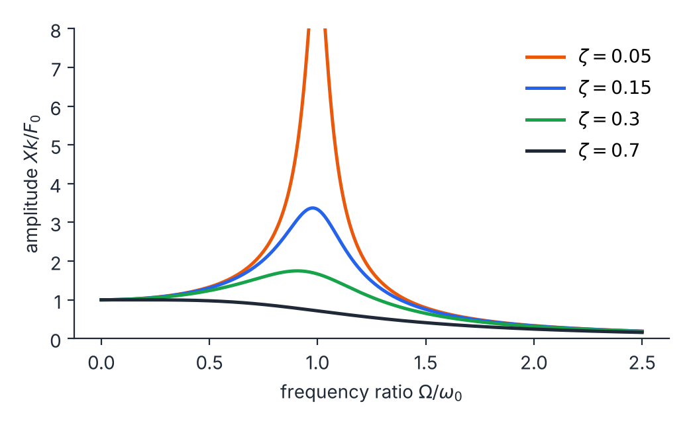

# Lab notes: driven air-track oscillator

*Notes kept in Markdown. HyperTeX reads them like any other document: the math, the tables, the task list and
the footnotes all work, and links go straight to equations in the [report](report.htex). The measurements are simulated for illustration.*

## Setup

- Cart of mass $m = 0.402\ \mathrm{kg}$ on an air track, held between two springs
- A motor drives one spring end with a small amplitude, $F_0 / k \approx 1.0\ \mathrm{mm}$
- Position read by an ultrasonic sensor at 50 samples per second[^sensor]

Checklist before each run:

- [x] Level the track (bubble level, both ends)
- [x] Let the cart settle for 30 s after changing the frequency
- [x] Record the steady amplitude, not the first swings
- [ ] Repeat the three points nearest the peak

## Free decay

Released from $x_0 = 40\ \mathrm{mm}$, the amplitude fell to half in $n_{1/2} = 1.8$ swings. For light damping
the amplitude shrinks by $e^{-2\pi\zeta}$ per swing, so

$$
\zeta = \frac{\ln 2}{2\pi n_{1/2}} = \frac{0.693}{2\pi \times 1.8} \approx 0.061 .
$$

## Driven response

Steady amplitude relative to the static deflection $F_0/k$. The last column is the prediction from
[equation (4) of the report](report.htex#eq:amp) with $f_0 = 1.62\ \mathrm{Hz}$ and $\zeta = 0.061$.

| Drive $f$ (Hz) | $r = f / f_0$ | Measured $X k/F_0$ | Predicted |
|---:|---:|---:|---:|
| 0.80 | 0.494 | 1.40 | 1.32 |
| 1.20 | 0.741 | 2.01 | 2.17 |
| 1.40 | 0.864 | 3.69 | 3.65 |
| 1.50 | 0.926 | 5.40 | 5.50 |
| 1.55 | 0.957 | 6.84 | 6.94 |
| 1.60 | 0.988 | 8.08 | 8.13 |
| 1.62 | 1.000 | 7.70 | 8.20 |
| 1.65 | 1.019 | 7.65 | 7.71 |
| 1.70 | 1.049 | 5.97 | 6.13 |
| 1.80 | 1.111 | 4.06 | 3.69 |
| 2.00 | 1.235 | 1.85 | 1.83 |
| 2.40 | 1.481 | 0.82 | 0.83 |

The largest measured value, $8.08$, matches the peak height $1/(2\zeta\sqrt{1-\zeta^2}) = 8.2$ from the
[resonance proposition](report.htex#prop:peak) within about 2%.

## Next

- Watch the motion in the [animated demo](demo.html)
- Full derivation in the [appendix](derivation.htex)
- The fitted values are summarised in [table 2 of the report](report.htex#tab:fit)

[^sensor]: The sensor has about 0.3 mm of noise, which is why the points near the peak scatter most.
